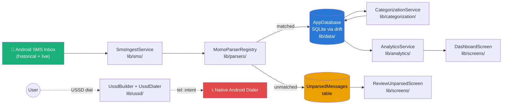

# i-momo

Offline mobile money spending tracker. Reads MTN MoMo (and eventually
Airtel Money) SMS directly from the phone's inbox, classifies each
transaction with a rule-based parser, and gives you spending analytics —
entirely on-device. No network permission is declared anywhere in the
app; it cannot phone home even by accident.

Android-only: SMS inbox access and USSD dialing are Android platform
features. iOS blocks third-party apps from reading SMS entirely.

## Features

- **Onboarding + initial ingestion.** First launch explains why SMS
  access is needed, requests the permission, then scans every existing
  MoMo message already in the inbox with a live progress screen
  (`X of Y messages checked`, running match count) before landing on the
  dashboard — so your full history is there from minute one, not just
  transactions that arrive afterward.
- **Periodic tracker.** The dashboard has a Week / Month / Quarter / Year
  selector with prev/next navigation, plus a "±X% vs previous period"
  delta badge on spend, so you can compare this month to last month, this
  quarter to last quarter, and so on.
- **Uncategorized-expense workflow.** Three tabs on the Categorize
  screen: the uncategorized queue, an "all transactions" view for
  editing/reassigning a category after the fact, and category management
  (rename/delete). Categorizing one transaction offers a one-tap "apply
  to N similar transactions" bulk action when other uncategorized
  transactions look like the same counterparty.

## Status

This project was hand-written without a local Flutter SDK to run
`flutter create`/`flutter pub get` against, so **nothing has been
compiled or run yet**. Treat the code as a structurally complete first
draft that needs a real toolchain pass before it will build.

## Setup

1. Install the Flutter SDK (stable channel) and the Android SDK/toolchain.
   `flutter doctor` should report no blocking issues for Android.
2. From this directory: `flutter pub get`
3. Generate the drift database code (required — `database.g.dart` does
   not exist yet, drift generates it from `lib/data/database.dart`):
   `dart run build_runner build --delete-conflicting-outputs`
4. Run the parser/database unit tests (no device needed):
   `flutter test`
5. Connect an Android device or start an emulator, then:
   `flutter run`

## Before trusting real transactions

The regex patterns in `lib/parsers/mtn_rwanda_parser.dart` and the
fixtures in `test/fixtures/mtn_rwanda/` are **placeholders** — public
web research could not surface verbatim MTN Rwanda MoMo SMS text, so
they follow the general MoMo message shape (amount, counterparty,
TxId, running balance) rather than confirmed real wording. See
`test/fixtures/mtn_rwanda/README.md` for the exact steps to replace them
with real messages from your own phone. Until that's done, expect real
MoMo SMS to land in the "Review" tab as unparsed rather than being
misclassified — the pipeline is designed to fail safe, not silently.

Also confirm the real MTN Rwanda MoMo sender ID/short code and update
`MtnRwandaParser.knownSenders` — the values there are placeholders too.

**Dependency risk:** the `telephony` package (SMS read + live listener,
`lib/sms/sms_ingest_service.dart`) is archived/unmaintained upstream. Its
public API was verified against the final `develop` branch and matches
what this codebase calls, but there will be no fixes for future Android
SDK breakage. If it stops working on a newer Android version, the
fallback is to reimplement `SmsIngestService`'s two responsibilities
(reading `content://sms/inbox` and registering a `SMS_RECEIVED`
broadcast receiver) directly via platform channels — nothing else in
the app depends on the `telephony` package's types beyond that one file.

The `*182#` USSD menu option numbers in `lib/ussd/ussd_builder.dart`
should also be verified on a real device before relying on the quick-dial
screen, since carriers change USSD menus without notice.

## Documentation

Full architecture diagrams (system context, data flow, sequence
diagrams, ER diagram, state machines) live in [docs/ARCHITECTURE.md](docs/ARCHITECTURE.md).
This README covers only the quick orientation version.

## Architecture at a glance



**No network layer exists in this diagram on purpose** — every arrow
terminates on-device. Adding a new provider/country means: implement
`MomoParser`, add fixtures, register the instance in
`MomoParserRegistry`. Nothing else in the diagram changes.

## Project layout

```
lib/
  data/            AppDatabase (drift/SQLite schema)
  parsers/         MomoParser interface, MtnRwandaParser, registry
  sms/             SmsIngestService — permissions, scan (with progress), live listener
  categorization/  CategorizationService — user-driven code bank, bulk-similar, category CRUD
  analytics/       AnalyticsService, Period (week/month/quarter/year), ChartPalette
  ussd/            UssdBuilder, UssdDialer
  screens/         Onboarding, Dashboard, Categorize, ReviewUnparsed, Ussd screens
  main.dart        App entry + HomeShell (onboarding gate, bottom nav, singleton wiring)
test/
  parsers/         Parser unit tests (incl. embedded-date extraction)
  analytics/       Period unit tests (week/month/quarter/year boundaries)
  data/            Database unit tests
  fixtures/        Sample SMS bodies per provider/transaction type
docs/
  ARCHITECTURE.md  Full diagram set + design rationale
```
