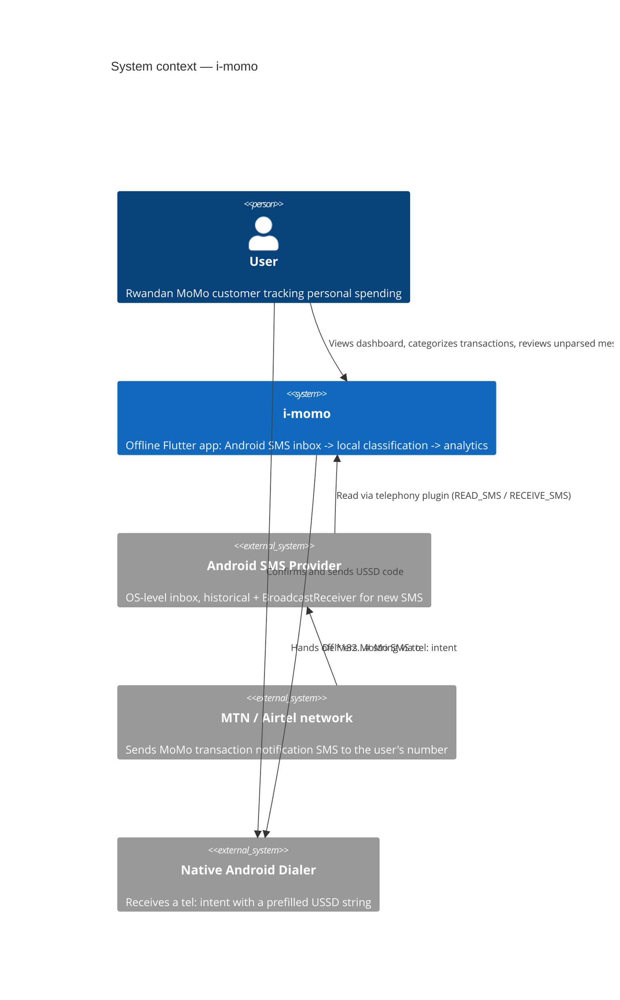
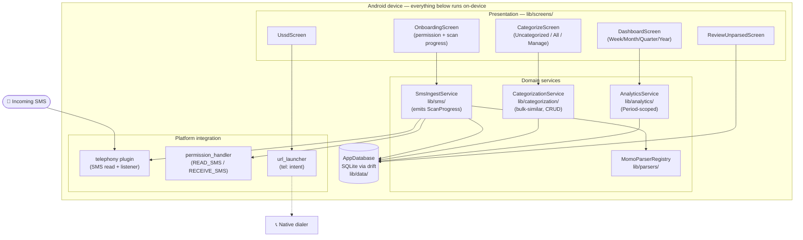
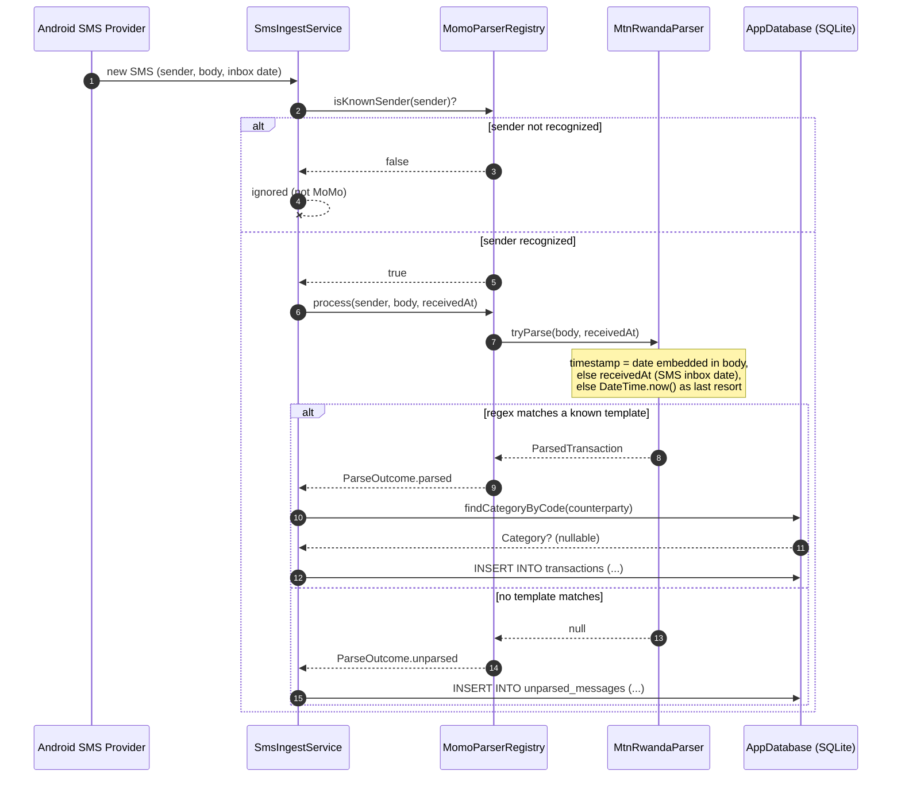
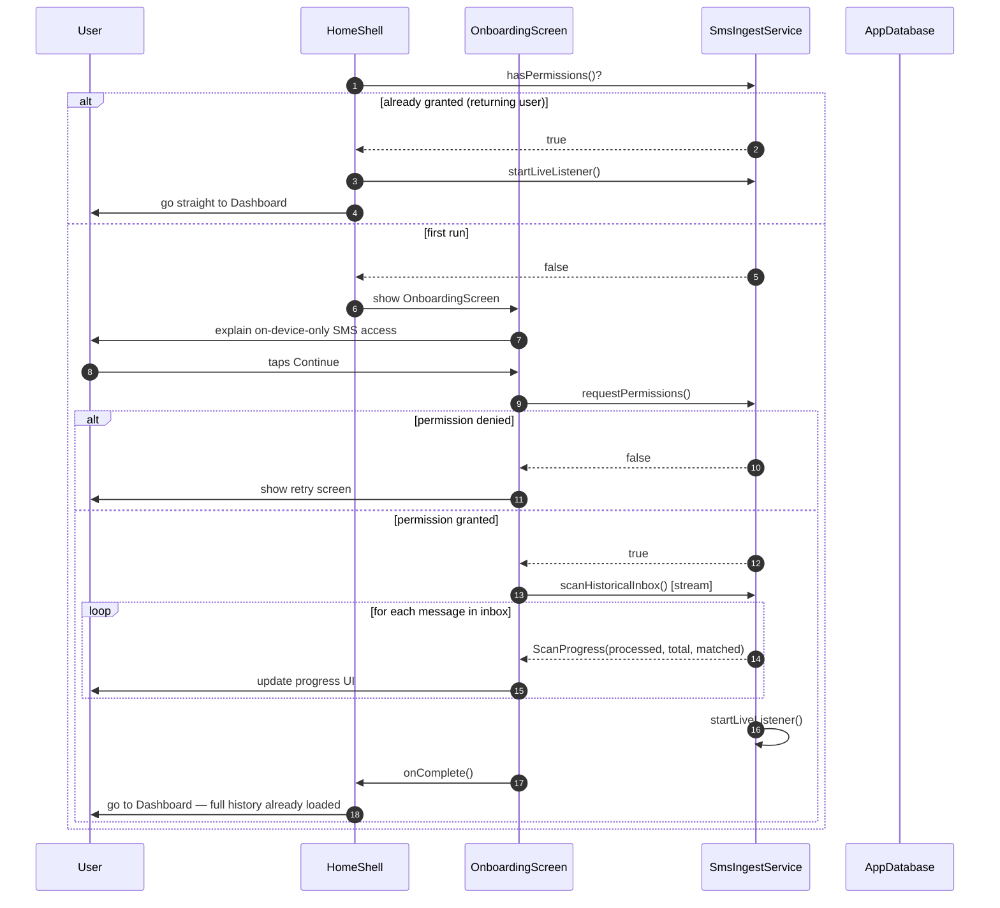
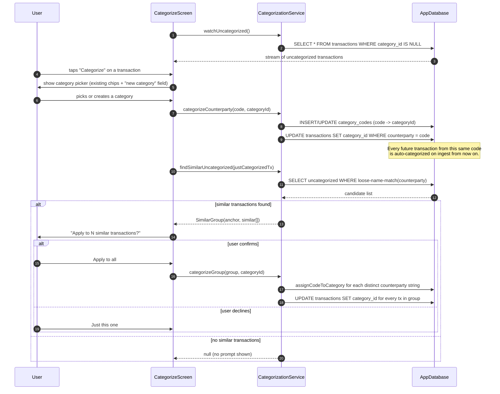
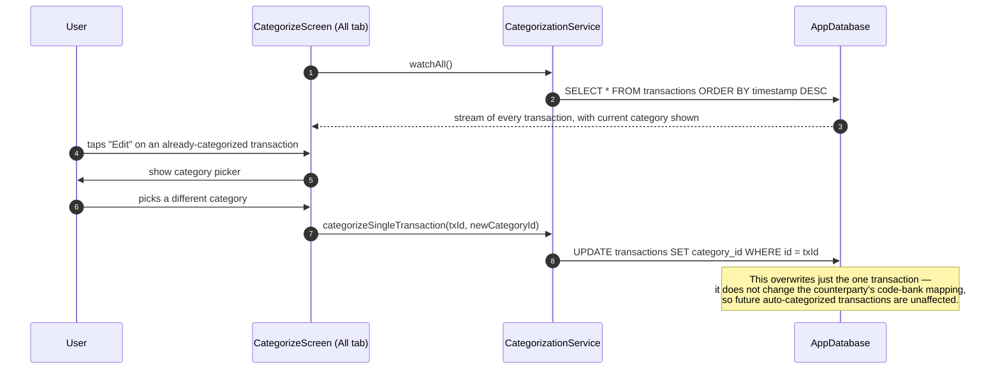
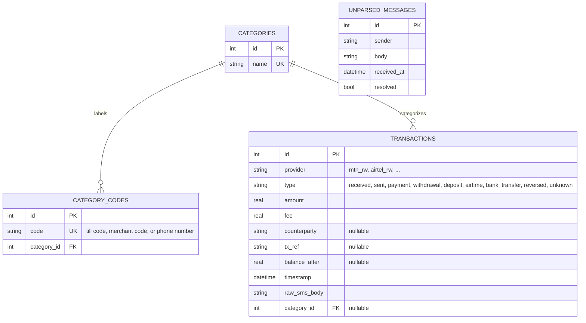
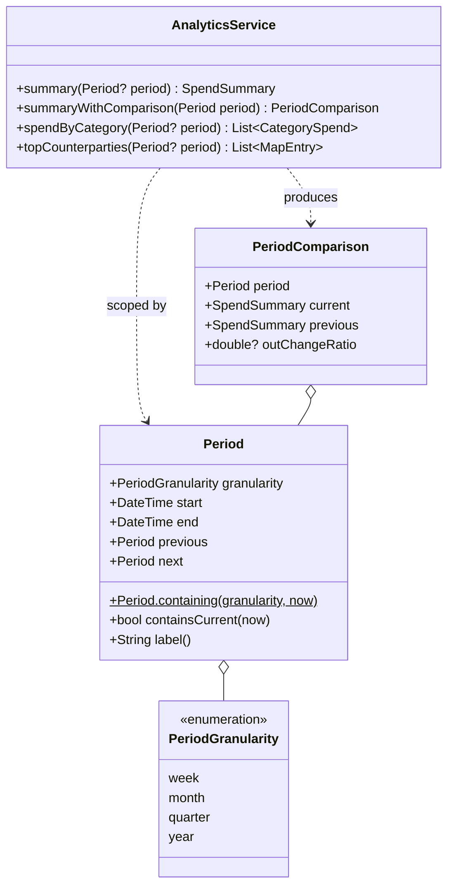
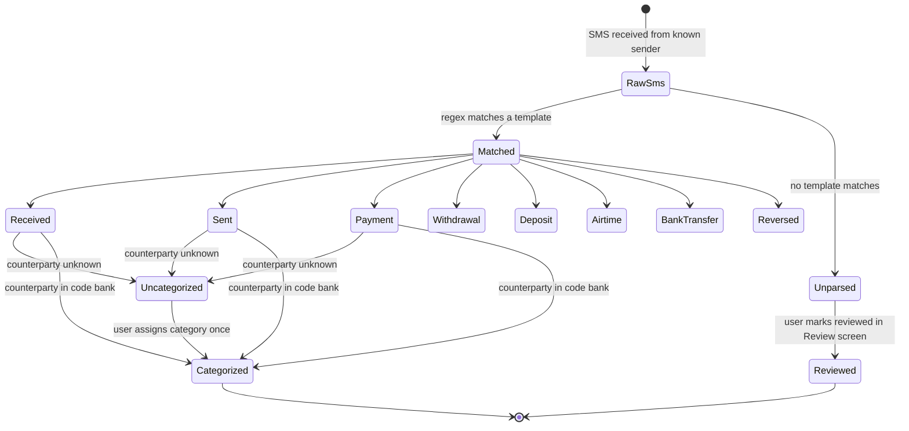
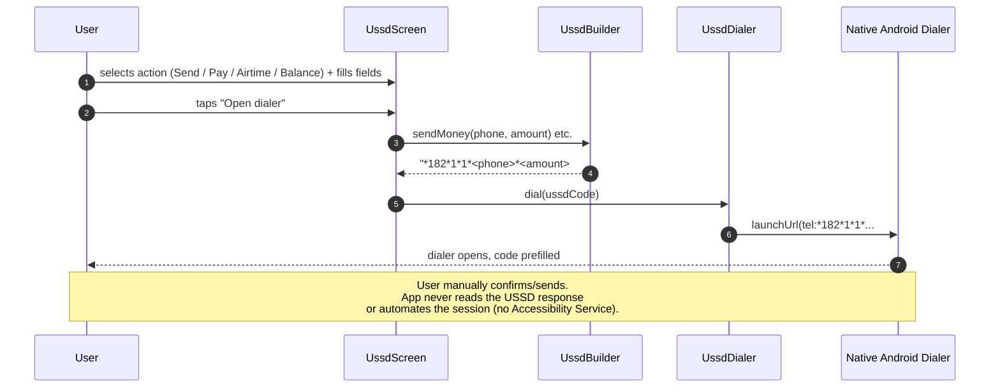

# i-momo Architecture

This document is the detailed design reference for the codebase in
`../lib`. See the top-level [README.md](../README.md) for setup steps.

## 1. Design principles

1. **Offline by construction, not by convention.** No `INTERNET` /
   `ACCESS_NETWORK_STATE` permission is declared in
   `android/app/src/main/AndroidManifest.xml`. If the app can't declare
   the permission, it can't open a socket — this is enforced at the
   platform level, not just by not writing network code.
2. **Rule-based classification, not ML.** MoMo SMS follows fixed
   templates per transaction type, so a regex parser per provider is
   deterministic, instant, needs no training data, and is trivial to
   extend when a new message format appears.
3. **Fail safe, not silent.** Any message from a known MoMo sender that
   no parser recognizes is stored in `UnparsedMessages` and surfaced in
   the Review screen — never silently dropped or guessed at.
4. **User-driven categorization, no seed data.** The `CategoryCodes`
   table starts empty. The first time a merchant/till code is seen, the
   user labels it once; every future transaction from that code is
   auto-categorized from then on. Categorizing one transaction also
   offers to bulk-apply the same category to other uncategorized
   transactions that look like the same counterparty (loose name match,
   not just exact code equality), and any categorization — including
   ones made automatically from the code bank — can be edited later.
5. **Pluggable providers.** Adding MTN Uganda, Airtel Rwanda, etc. means
   writing one new `MomoParser` implementation and registering it — no
   changes anywhere else in the pipeline.
6. **Full history from minute one.** Onboarding requests SMS permission
   with a plain-language explanation, then streams progress while every
   MoMo message already in the inbox is scanned and classified — so
   the periodic tracker has real history to show immediately rather
   than only accumulating from first launch onward.
7. **Reports are periodic, not just a rolling window.** The dashboard is
   scoped to a navigable Week / Month / Quarter / Year window (see
   `Period` in §6a) with prev/next navigation and a period-over-period
   delta, rather than only ever showing "all time" or a fixed last-N-days
   range.

## 2. System context



No arrow ever leaves the phone. The only two external actors are the
OS-level SMS provider (read-only) and the native dialer (write-only,
user-confirmed).

## 3. Container / module view



`HomeShell` (in `main.dart`) is the gate between the two: it checks
`SmsIngestService.hasPermissions()` once at startup, shows
`OnboardingScreen` only when permission hasn't been granted yet, and
otherwise resumes the live listener and goes straight to the bottom-nav
shell (Dashboard / Categorize / Review / Dial).

## 4. Data flow — ingesting one SMS



The `receivedAt` fallback matters most during the historical scan: a
message from 8 months ago must be dated 8 months ago, not "now," or
every periodic report (§6a) would bucket all historical spend into
whichever period the scan happened to run in.

## 4a. Initial setup — onboarding + full-history ingestion



`scanHistoricalInbox()` is a `Stream<ScanProgress>` rather than a single
`Future<int>` specifically so the onboarding screen can render live
counts instead of an indeterminate spinner while potentially thousands
of messages are scanned.

## 5. Sequence — categorizing a new merchant code, with bulk-similar



"Loose-name-match" is a case-insensitive comparison of the leading
alphabetic token of the counterparty string (e.g. "SUPERMARKET" from
both "SUPERMARKET LTD (Code: 55123)" and "SUPERMARKET LTD - TILL 2"),
not exact string equality — that's what lets one categorization catch
near-duplicate counterparty spellings instead of only exact repeats. It
deliberately returns nothing for purely numeric counterparties (bare
phone numbers), so unrelated P2P transfers never get grouped by
coincidence.

## 5a. Editing an existing categorization



Category management itself (rename/delete) is a third tab on the same
screen and talks directly to the `categories` table; deleting a category
sets `category_id` back to `NULL` on every transaction that referenced
it (nullable FK, not a cascade delete) rather than deleting those
transactions.

## 6. Entity-relationship diagram



`UNPARSED_MESSAGES` has no foreign key relationship — it's a holding
queue, not part of the transaction graph, until a human (or an updated
parser) resolves it.

## 6a. The periodic tracker — `Period` model

The dashboard scopes every query to a navigable `Period` (see
`lib/analytics/period.dart`) rather than a fixed "last N days" window.
A `Period` pairs a `PeriodGranularity` (week/month/quarter/year) with a
concrete `[start, end)` range and knows how to shift itself forward or
backward one unit at a time — that's what powers the dashboard's ◀ / ▶
navigation and the "vs previous period" delta.



Week starts Monday (`DateTime.monday`); quarters are calendar quarters
(Q1 = Jan–Mar, etc.), not fiscal quarters. `end` is always exclusive, so
every scoped query is `timestamp >= period.start AND timestamp <
period.end` — this is what makes `previous`/`next` composable without
off-by-one boundary bugs (a transaction at exactly midnight on a month
boundary belongs to exactly one of the two adjacent periods, never both
or neither).

`summaryWithComparison` runs the same query twice — once for the
selected period, once for `period.previous` — and exposes
`outChangeRatio` so the dashboard can render "23% more spent than last
month" without the UI layer doing date math itself.

## 7. Transaction type state/classification model



## 8. Parser extensibility pattern

```mermaid
classDiagram
    class MomoParser {
        <<interface>>
        +String providerId
        +Set~String~ knownSenders
        +bool ownsSender(sender)
        +ParsedTransaction? tryParse(body, receivedAt)
    }

    class MtnRwandaParser {
        +providerId = "mtn_rw"
        +knownSenders = {M-Money, MTN, MoMo}
        +tryParse(body, receivedAt) ParsedTransaction?
    }

    class AirtelRwandaParser {
        <<planned>>
        +providerId = "airtel_rw"
        +tryParse(body, receivedAt) ParsedTransaction?
    }

    class MomoParserRegistry {
        +List~MomoParser~ parsers
        +isKnownSender(sender) bool
        +process(sender, body, receivedAt) ParseOutcome
    }

    class ParsedTransaction {
        +TransactionType type
        +double amount
        +double fee
        +String? counterparty
        +String? txRef
        +double? balanceAfter
        +DateTime timestamp
    }

    MomoParser <|.. MtnRwandaParser
    MomoParser <|.. AirtelRwandaParser
    MomoParserRegistry o-- MomoParser : holds many
    MomoParser ..> ParsedTransaction : produces
```

To add a provider: implement `MomoParser`, add fixture SMS + unit tests
under `test/fixtures/<provider>/`, and add one line to
`MomoParserRegistry`'s constructor. `SmsIngestService`, the database
schema, categorization, and analytics never need to change.

## 9. USSD quick-dial flow (no session automation)



## 10. Why these tradeoffs

| Decision | Alternative considered | Why rejected |
|---|---|---|
| Regex parser, no ML | On-device TFLite classifier | MoMo SMS is template-structured; ML adds training-data, model-size, and debuggability overhead for a problem regex already solves deterministically |
| No seed data for categories | Ship a starter merchant→category bank | User explicitly wants full control; a wrong auto-guess is worse than one extra tap the first time a code is seen |
| `tel:` intent hand-off for USSD | Accessibility Service session automation | Automating USSD sessions is fragile across OEM dialers/Android versions and closer to a permissions/security gray area for marginal convenience gain |
| drift/SQLite over a NoSQL/file store | Flat file (JSON/CSV) | Analytics needs grouped aggregation (`SUM ... GROUP BY category`) — SQL is the right tool, and drift adds compile-time query safety |
| Fail-to-review-queue over best-effort guess | Regex with loose fallback matching | A wrong transaction type/amount silently corrupts analytics; an unparsed message sitting in a queue is visible and fixable |
| Embedded-date-then-inbox-date-then-now fallback chain | Always use `DateTime.now()` at ingest time (the original implementation) | Historical scan would date every past transaction to the scan moment, collapsing months of history into one period and making the periodic tracker meaningless for anything but freshly-arriving messages |
| Loose substring bulk-categorize, confirmed per-batch | Auto-apply silently whenever a substring matches | A silent auto-apply on a fuzzy (not exact) match risks mis-categorizing an unrelated transaction that happens to share a word; a confirmation dialog costs one tap and eliminates that risk |
| Nullable FK + reassign-to-NULL on category delete | Cascade-delete transactions when their category is deleted | A transaction is a fact (money moved); deleting the label it wore should never destroy the record of the money movement itself |
| Streamed `ScanProgress` for onboarding | Fire-and-forget scan behind a plain spinner (the original implementation) | A historical inbox can be thousands of messages; an indeterminate spinner gives no signal the app hasn't hung, whereas live counts confirm forward progress |
