# i-momo Architecture

This document is the detailed design reference for the codebase in
`../lib`. See the top-level [README.md](../README.md) for setup steps.

## 1. Design principles

1. **Offline by construction, not by convention.** No `INTERNET` /
   `ACCESS_NETWORK_STATE` permission is declared in
   `android/app/src/main/AndroidManifest.xml`. If the app can't declare
   the permission, it can't open a socket — this is enforced at the
   platform level, not just by not writing network code.
2. **Rule-based classification, not ML.** MoMo SMS follows fixed
   templates per transaction type, so a regex parser per provider is
   deterministic, instant, needs no training data, and is trivial to
   extend when a new message format appears.
3. **Fail safe, not silent.** Any message from a known MoMo sender that
   no parser recognizes is stored in `UnparsedMessages` and surfaced in
   the Review screen — never silently dropped or guessed at.
4. **User-driven categorization, no seed data.** The `CategoryCodes`
   table starts empty. The first time a merchant/till code is seen, the
   user labels it once; every future transaction from that code is
   auto-categorized from then on. Categorizing one transaction also
   offers to bulk-apply the same category to other uncategorized
   transactions that look like the same counterparty (loose name match,
   not just exact code equality), and any categorization — including
   ones made automatically from the code bank — can be edited later.
5. **Pluggable providers.** Adding MTN Uganda, Airtel Rwanda, etc. means
   writing one new `MomoParser` implementation and registering it — no
   changes anywhere else in the pipeline.
6. **Full history from minute one.** Onboarding requests SMS permission
   with a plain-language explanation, then streams progress while every
   MoMo message already in the inbox is scanned and classified — so
   the periodic tracker has real history to show immediately rather
   than only accumulating from first launch onward.
7. **Reports are periodic, not just a rolling window.** The dashboard is
   scoped to a navigable Week / Month / Quarter / Year window (see
   `Period` in §6a) with prev/next navigation and a period-over-period
   delta, rather than only ever showing "all time" or a fixed last-N-days
   range.

## 2. System context

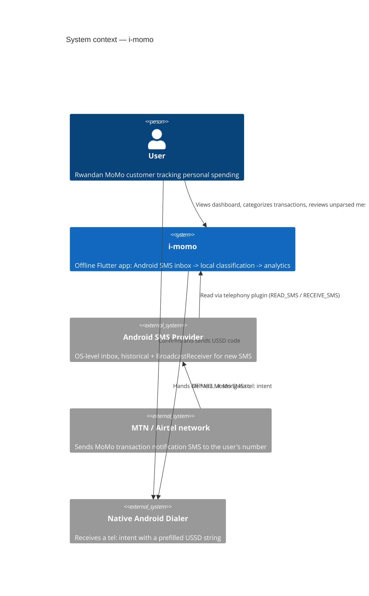

No arrow ever leaves the phone. The only two external actors are the
OS-level SMS provider (read-only) and the native dialer (write-only,
user-confirmed).

## 3. Container / module view

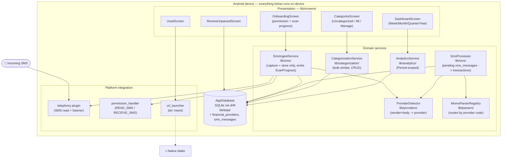

`HomeShell` (in `main.dart`) is the gate between the two: it checks
`SmsIngestService.hasPermissions()` once at startup, shows
`OnboardingScreen` only when permission hasn't been granted yet, and
otherwise resumes the live listener and goes straight to the bottom-nav
shell (Dashboard / Categorize / Review / Dial).

## 4. Data flow — ingesting one SMS (v2 pipeline, Phase 1)

**This replaced a direct SMS→Transaction pipeline** that shipped in v1.
The v1 shape — parse-and-insert in one step, with no permanent,
provider-attributed record of the raw evidence — was audited and found
to be the wrong architecture (see `docs/AUDIT_PHASE_0.md` §1, §3.5,
§3.6): it made re-scans double-insert (no dedup key existed), made a
parser bug unrecoverable without re-reading the phone's SMS inbox
again, and gave "provider" no real identity beyond a free-text string.

The pipeline is now a strict two-stage split, matching the "SMS → Raw
Event → Provider Parser → Normalized Transaction" shape:

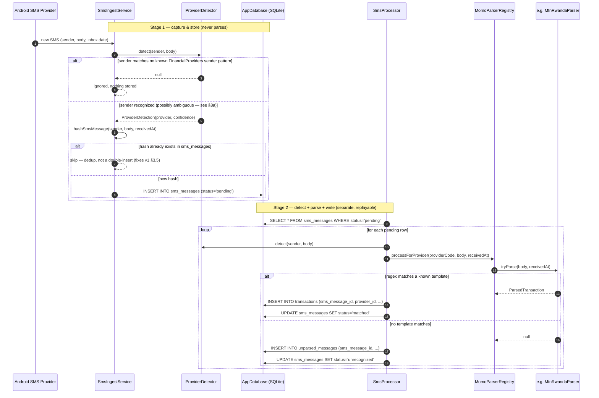

Two consequences of this split that weren't possible in v1:

- **Reprocessing.** Fixing `MtnRwandaParser`'s regex and re-running
  `SmsProcessor.processPending()` (or a future "reprocess unrecognized"
  action) re-derives transactions from stored evidence — no phone, no
  re-scan, no risk of the user having deleted the original SMS since.
- **Provider identity is real.** `sms_messages.provider_id` and
  `transactions.provider_id` are foreign keys into `financial_providers`
  (§8), not a free-text tag — see §8a for how one sender can resolve to
  different providers depending on body content (the confirmed real
  `M-Money` → MTN MoMo vs. eKash case).

The `receivedAt` fallback (body date → SMS inbox date → `DateTime.now()`
as last resort) still matters most during the historical scan: a
message from 8 months ago must be dated 8 months ago, not "now," or
every periodic report (§6a) would bucket all historical spend into
whichever period the scan happened to run in. That logic is unchanged,
just now lives inside each `MomoParser.tryParse` as before.

## 4a. Initial setup — onboarding + full-history ingestion

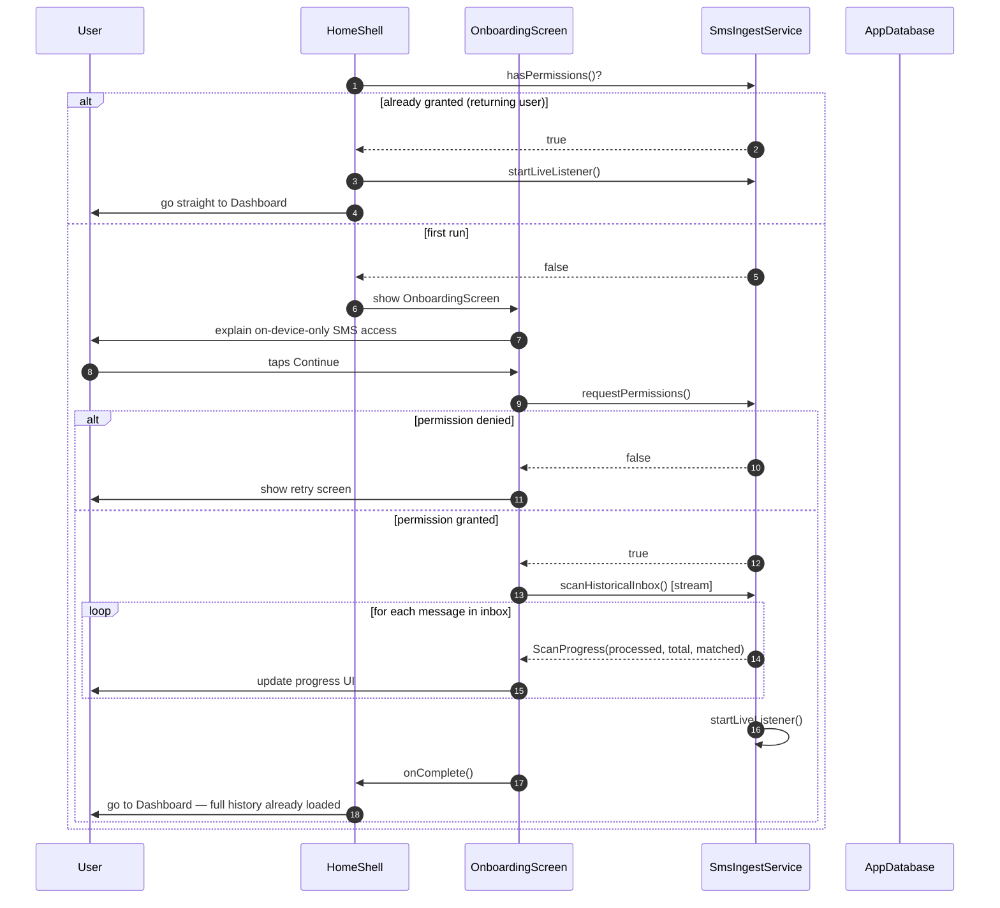

`scanHistoricalInbox()` is a `Stream<ScanProgress>` rather than a single
`Future<int>` specifically so the onboarding screen can render live
counts instead of an indeterminate spinner while potentially thousands
of messages are scanned.

## 5. Sequence — categorizing a new merchant code, with bulk-similar

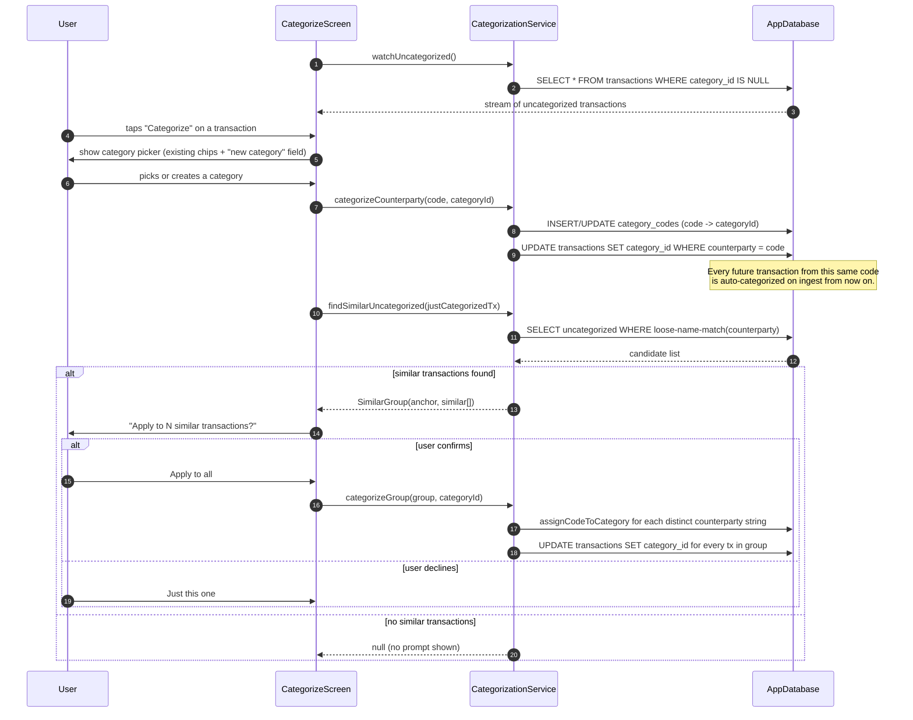

"Loose-name-match" is a case-insensitive comparison of the leading
alphabetic token of the counterparty string (e.g. "SUPERMARKET" from
both "SUPERMARKET LTD (Code: 55123)" and "SUPERMARKET LTD - TILL 2"),
not exact string equality — that's what lets one categorization catch
near-duplicate counterparty spellings instead of only exact repeats. It
deliberately returns nothing for purely numeric counterparties (bare
phone numbers), so unrelated P2P transfers never get grouped by
coincidence.

## 5a. Editing an existing categorization

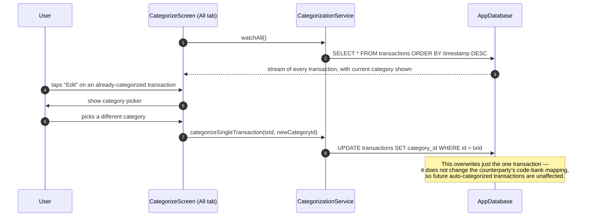

Category management itself (rename/delete) is a third tab on the same
screen and talks directly to the `categories` table; deleting a category
sets `category_id` back to `NULL` on every transaction that referenced
it (nullable FK, not a cascade delete) rather than deleting those
transactions.

## 6. Entity-relationship diagram (v3, Phases 1-4)

`FINANCIAL_PROVIDERS`, `PROVIDER_SENDERS`, and `SMS_MESSAGES` are new in
v2 (§8, §8a). `ACCOUNTS`, `MERCHANTS`, and `TRANSFER_LINKS` are new in v3
(§8b). `TRANSACTIONS.provider` (a bare string in v1) became
`TRANSACTIONS.provider_id`, a real foreign key.

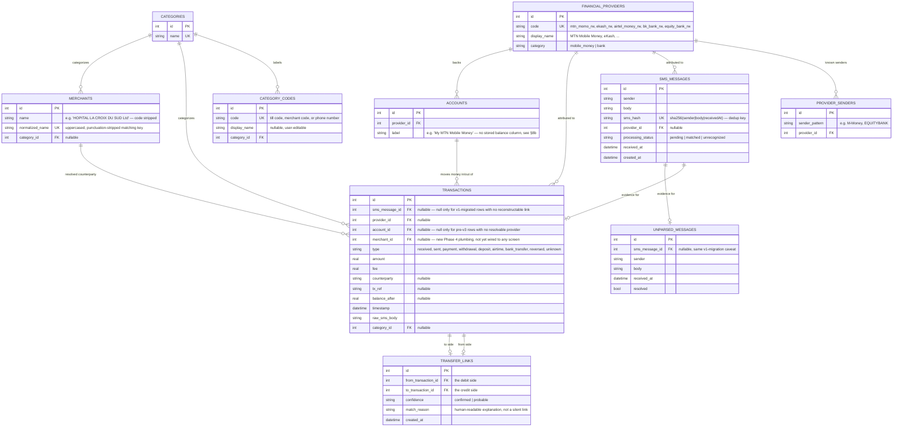

`PROVIDER_SENDERS.sender_pattern` is deliberately many-to-one with
`FINANCIAL_PROVIDERS`, not one-to-one: the confirmed real case is MTN
Rwanda's `M-Money` shortcode, which is a registered sender for *both*
`mtn_momo_rw` and `ekash_rw` (see §8a). `SMS_MESSAGES` is the permanent
evidence table — `TRANSACTIONS`/`UNPARSED_MESSAGES` link back to it via
`sms_message_id`, but that link is nullable specifically to accommodate
rows migrated from v1, where no sender was ever stored on a transaction
and the original SMS text (`raw_sms_body`) is the only surviving trace
(the migration backfills a best-effort `SMS_MESSAGES` row for these too,
using the transaction's resolved provider's first known sender as a
documented approximation — see `AppDatabase._backfillSmsMessagesFromV1`
in `lib/data/database.dart`).

`ACCOUNTS` has no balance column at all — see §8b for why an account's
current balance is always computed from `TRANSACTIONS.balance_after`,
never stored. `TRANSFER_LINKS` connects two `TRANSACTIONS` rows without
ever deleting or merging either one; both remain the real evidence of
what each provider actually reported. `MERCHANTS` is additive alongside
`CATEGORY_CODES` — see §8b for why the existing categorization screens
were deliberately left reading from `CATEGORY_CODES` rather than
migrated in the same change that introduced `MERCHANTS`.

## 6a. The periodic tracker — `Period` model

The dashboard scopes every query to a navigable `Period` (see
`lib/analytics/period.dart`) rather than a fixed "last N days" window.
A `Period` pairs a `PeriodGranularity` (week/month/quarter/year) with a
concrete `[start, end)` range and knows how to shift itself forward or
backward one unit at a time — that's what powers the dashboard's ◀ / ▶
navigation and the "vs previous period" delta.

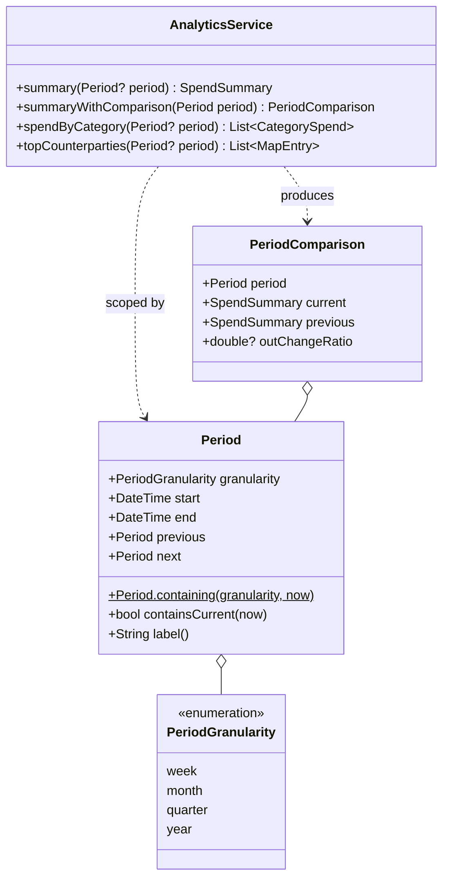

Week starts Monday (`DateTime.monday`); quarters are calendar quarters
(Q1 = Jan–Mar, etc.), not fiscal quarters. `end` is always exclusive, so
every scoped query is `timestamp >= period.start AND timestamp < period.end` — this is what makes `previous`/`next` composable without
off-by-one boundary bugs (a transaction at exactly midnight on a month
boundary belongs to exactly one of the two adjacent periods, never both
or neither).

`summaryWithComparison` runs the same query twice — once for the
selected period, once for `period.previous` — and exposes
`outChangeRatio` so the dashboard can render "23% more spent than last
month" without the UI layer doing date math itself.

## 7. Transaction type state/classification model

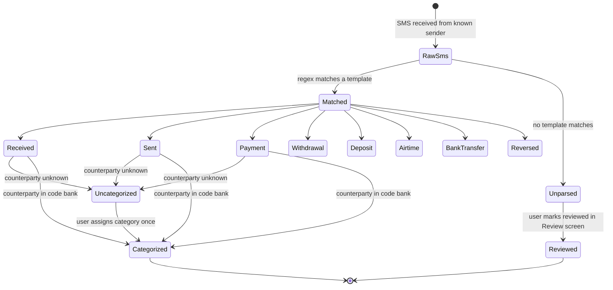

## 8. Parser extensibility pattern (v2)

**Who owns a sender and who parses a body are now two separate
concerns** — v1's `MomoParser` did both (`knownSenders` +
`ownsSender()` + `tryParse()`), which broke the moment one sender
carried more than one provider's traffic (§8a). In v2, `ProviderDetector`
(lib/providers/) owns sender resolution; `MomoParser` only knows its own
`providerCode` and how to read that provider's body format.

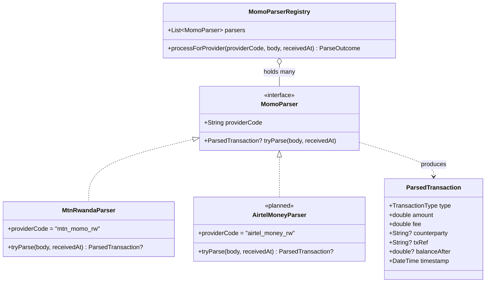

To add a provider: seed a `FinancialProviders` row + its
`ProviderSenders` patterns (`AppDatabase._seedProviders`), implement
`MomoParser` with a matching `providerCode`, add fixture SMS + unit
tests under `test/fixtures/<provider>/`, and add one line to
`MomoParserRegistry`'s constructor. `SmsIngestService`, `SmsProcessor`,
the categorization logic, and analytics never need to change.

## 8a. Provider disambiguation — one sender, multiple providers

Confirmed real case (`docs/AUDIT_PHASE_0.md` §3.2, §3.1): MTN Rwanda's
`M-Money` shortcode carries both genuine MTN MoMo traffic and eKash
traffic — two different providers sharing one sender ID. Sender alone
cannot distinguish them; `ProviderDetector.detect` resolves the tie by
body content:

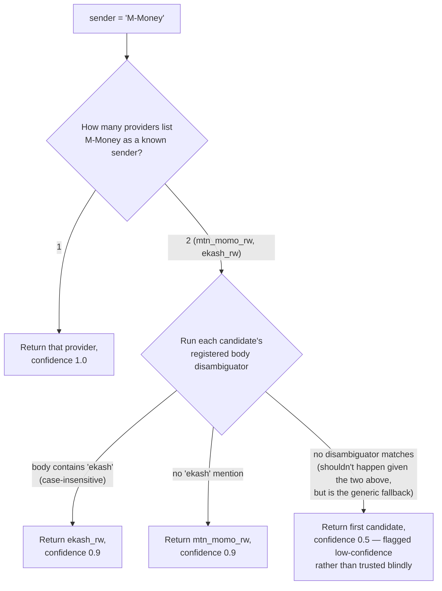

Disambiguators are registered per provider code in
`lib/providers/provider_detector_factory.dart`, kept separate from the
generic `ProviderDetector` class so provider-specific body heuristics
live next to the provider they describe, not baked into the detection
engine itself. Adding a new ambiguous-sender case later (e.g. if a bank
shares a shortcode with a partner service) means adding one
`registerDisambiguator` call there — no changes to `ProviderDetector`,
`SmsIngestService`, or `SmsProcessor`.

## 8b. Multi-provider parsing, transfer matching, and merchant normalization (Phases 2-4)

**Phase 2 — real pattern library.** `MtnRwandaParser`'s regex was
rewritten entirely from real message text (a genuine 8,364-message SMS
export analyzed in `docs/AUDIT_PHASE_0.md`), replacing a placeholder
version that matched zero real messages. Four new parsers were added
against the same real evidence: `EkashParser`, `AirtelMoneyParser`,
`EquityBankParser`, `BkBankParser` — each registered in
`MomoParserRegistry` alongside `MtnRwandaParser`, routed by
`providerCode` exactly as described in §8. The full catalog of real
message shapes per provider — including confirmed real inconsistencies
like Airtel's `sent` message having three different field-naming
variants, and BK changing its own `TRANSFER` message format between an
older Kinyarwanda version and a newer English one — is documented in
`docs/SMS_PATTERN_LIBRARY.md`, which is the reference to check before
writing a new parser or debugging an unmatched real message.

**Phase 3 — accounts and transfer matching.**

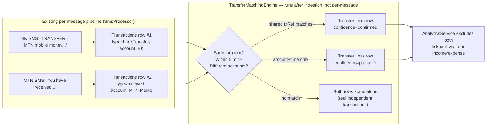

Two schema additions back this: `Accounts` (one row per seeded
`FinancialProviders` row today, e.g. "My MTN Mobile Money" — deliberately
carries **no stored balance column**; `AccountsService.currentBalance`
always computes it fresh from the most recent `Transactions.balanceAfter`
for that account, so there is never a second source of truth that could
drift from the real ledger) and `TransferLinks` (connects two
`Transactions` rows without deleting or merging either — both remain
the real evidence of what each provider actually reported).

`TransferMatchingEngine.findAndLinkTransfers()` is **not** run inline
per-message inside `SmsProcessor` — the matching counterpart of a
transfer may not have arrived yet when the first side is processed, so
it runs as an explicit batch step in `main.dart`, right after the
historical scan completes and again on every subsequent app launch
where SMS permission is already granted. It's idempotent: already-linked
transactions are excluded from the search on every run (also enforced by
`TransferLinks`'s own unique key), so calling it repeatedly never
creates duplicate links.

The confirmed real evidence this was built against (not a hypothetical):
an Equity `sent` message with `MTN Ref. 541077019015` and an MTN
`received` message with `Financial Transaction Id: 13583914317` whose
body explicitly says "Transfer from ... Equity B2C" — same amount, 3
seconds apart, on both sides of one real transfer. `AnalyticsService`'s
`summary()`/`spendByCategory()`/`monthlySpend()`/`topCounterparties()`
all now exclude linked transaction ids from their totals — before this
fix, a matched transfer pair was counted as unrelated income *and*
expense, inflating both sides of the ledger for the same real movement
of money.

**Phase 4 — merchant name/code split.** Confirmed real bug
(`docs/AUDIT_PHASE_0.md` §3.3): `"HOPITAL LA CROIX DU SUD Ltd 100126"`
and similar counterparty strings store a merchant name and its trailing
till/account code as one opaque, uncategorizable blob. `Merchants`
(new table: `name`, `normalizedName`, `categoryId`) and
`MerchantNormalizationService` fix this — `extractMerchantName` strips a
trailing 4+-digit code (optionally dash-separated), and `normalize`
collapses casing/punctuation/whitespace so "Family Bakery Ltd" and
"FAMILY BAKERY LTD." resolve to the same row instead of two.

This is added **alongside**, not in place of, the existing
`CategoryCodes`-based flow — every `Transactions` row `SmsProcessor`
writes now also gets a `merchantId` (via `MerchantNormalizationService`)
and an `accountId` (via `AccountsService.defaultAccountForProvider`), but
the Categorize/Pay/Frequent-codes screens still read from `counterparty`

+ `CategoryCodes` exactly as before. Wiring those screens over to query
  `Merchants` instead is a deliberately separate follow-up — this phase
  built and tested the correct plumbing without risking the already-shipped
  UI in the same change.

## 9. USSD quick-dial flow (no session automation)

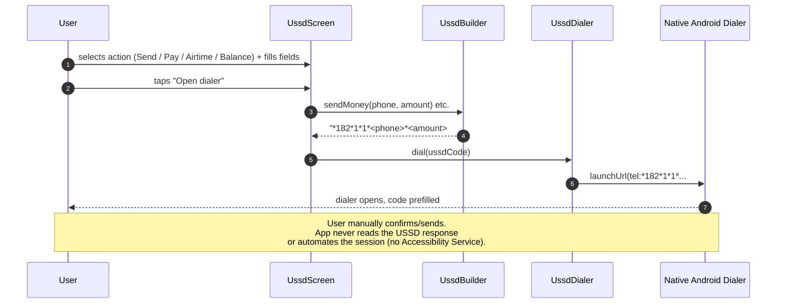

## 10. Why these tradeoffs

| Decision                                                                                   | Alternative considered                                                                   | Why rejected                                                                                                                                                                                                                                                                                                                                            |
| ------------------------------------------------------------------------------------------ | ---------------------------------------------------------------------------------------- | ------------------------------------------------------------------------------------------------------------------------------------------------------------------------------------------------------------------------------------------------------------------------------------------------------------------------------------------------------- |
| Regex parser, no ML                                                                        | On-device TFLite classifier                                                              | MoMo SMS is template-structured; ML adds training-data, model-size, and debuggability overhead for a problem regex already solves deterministically                                                                                                                                                                                                     |
| No seed data for categories                                                                | Ship a starter merchant→category bank                                                   | User explicitly wants full control; a wrong auto-guess is worse than one extra tap the first time a code is seen                                                                                                                                                                                                                                        |
| `tel:` intent hand-off for USSD                                                          | Accessibility Service session automation                                                 | Automating USSD sessions is fragile across OEM dialers/Android versions and closer to a permissions/security gray area for marginal convenience gain                                                                                                                                                                                                    |
| drift/SQLite over a NoSQL/file store                                                       | Flat file (JSON/CSV)                                                                     | Analytics needs grouped aggregation (`SUM ... GROUP BY category`) — SQL is the right tool, and drift adds compile-time query safety                                                                                                                                                                                                                  |
| Fail-to-review-queue over best-effort guess                                                | Regex with loose fallback matching                                                       | A wrong transaction type/amount silently corrupts analytics; an unparsed message sitting in a queue is visible and fixable                                                                                                                                                                                                                              |
| Embedded-date-then-inbox-date-then-now fallback chain                                      | Always use`DateTime.now()` at ingest time (the original implementation)                | Historical scan would date every past transaction to the scan moment, collapsing months of history into one period and making the periodic tracker meaningless for anything but freshly-arriving messages                                                                                                                                               |
| Loose substring bulk-categorize, confirmed per-batch                                       | Auto-apply silently whenever a substring matches                                         | A silent auto-apply on a fuzzy (not exact) match risks mis-categorizing an unrelated transaction that happens to share a word; a confirmation dialog costs one tap and eliminates that risk                                                                                                                                                             |
| Nullable FK + reassign-to-NULL on category delete                                          | Cascade-delete transactions when their category is deleted                               | A transaction is a fact (money moved); deleting the label it wore should never destroy the record of the money movement itself                                                                                                                                                                                                                          |
| Streamed`ScanProgress` for onboarding                                                    | Fire-and-forget scan behind a plain spinner (the original implementation)                | A historical inbox can be thousands of messages; an indeterminate spinner gives no signal the app hasn't hung, whereas live counts confirm forward progress                                                                                                                                                                                             |
| Two-stage capture-then-process pipeline (Phase 1)                                          | Keep v1's single-step SMS→Transaction parse                                             | Audited and confirmed as the wrong shape (`docs/AUDIT_PHASE_0.md` §1): no way to re-derive transactions after a parser fix without re-reading the phone's inbox, no dedup key, "provider" was a free string. Splitting capture (`SmsIngestService`) from parsing (`SmsProcessor`) makes reprocessing possible and gives provider a real identity |
| SHA-256 hash of`sender\|body\|receivedAt` as the dedup key                                 | A unique constraint on`txRef` alone                                                    | Not every real message carries a usable reference number (confirmed real MTN formats vary — some have`TxId`, some don't; see §3.2 in the audit), but every message has a sender, body, and timestamp, so the hash is always computable and still collision-safe in practice                                                                         |
| Real drift`onUpgrade` migration with backfill, not a destructive reset                   | Bump`schemaVersion` and let drift wipe/recreate                                        | This app's whole purpose is being a financial history; a schema change silently deleting a user's existing transaction history on their next app update would be a serious regression, not just an inconvenience                                                                                                                                        |
| Sender→provider is many-to-many via`ProviderSenders`, disambiguated by body content     | Assume one sender = one provider (v1's implicit assumption)                              | Confirmed false by real data: MTN Rwanda's`M-Money` shortcode carries both MoMo and eKash traffic. A body-content disambiguator (registered per ambiguous sender) is the minimum mechanism that actually resolves this correctly                                                                                                                      |
| Independent per-field regex extraction, not one sequential template per provider (Phase 2) | One strict left-to-right regex per message shape                                         | Confirmed real Airtel`sent` messages alone have three different field-naming variants (`Amount RWF X. CHARGES RWF Y`, no-space/no-RWF, `Amt`/`Fee`/`BAL`); a sequential pattern only ever matches the variant it was written against                                                                                                          |
| Account balance computed on read, never stored (Phase 3.2)                                 | A`balance` column on `Accounts`, updated on every transaction insert                 | Two sources of truth for the same number — a stored balance could silently drift from what the transaction history actually shows if a transaction is ever edited or deleted; for a financial ledger, history must remain the only source of truth                                                                                                     |
| Transfer matching as an explicit batch stage, not inline per-message (Phase 3.1)           | Check for a transfer match immediately inside`SmsProcessor` as each message is written | The matching counterpart of a transfer may not have arrived yet when the first side is processed (real evidence: the two sides of the same transfer arrived via different SMS, seconds apart) — a batch pass after ingestion is the only ordering that can see both sides reliably                                                                     |
| `TransferLinks` connects two `Transactions` rows; never merges or deletes either       | Replace both rows with one synthetic "transfer" transaction                              | Each row is the real evidence of what its own provider actually reported (its own txRef, its own exact wording) — collapsing them into one synthetic row would destroy that evidence for the sake of a slightly simpler analytics query                                                                                                                |
| `Merchants` added alongside `CategoryCodes`, existing screens left untouched (Phase 4) | Migrate Categorize/Pay/Frequent-codes screens to`Merchants` in the same change         | The categorization bug (merchant name + code stored as one opaque string) is real and confirmed, but the existing screens already work correctly against`CategoryCodes` today; introducing new plumbing and rewiring working, shipped UI in one change multiplies the blast radius of any mistake for no compounding benefit                          |
| Trailing-4+-digit-code stripping as the merchant/code split heuristic                      | Split on the last whitespace-separated token unconditionally                             | A trailing short number (1-3 digits) is more likely to be part of a name (e.g. a unit number) than an account code in the confirmed real examples; a 4-digit floor matches every real code observed (`096957`, `902850`, `08077`, `20231`) without over-stripping shorter tokens                                                                |
